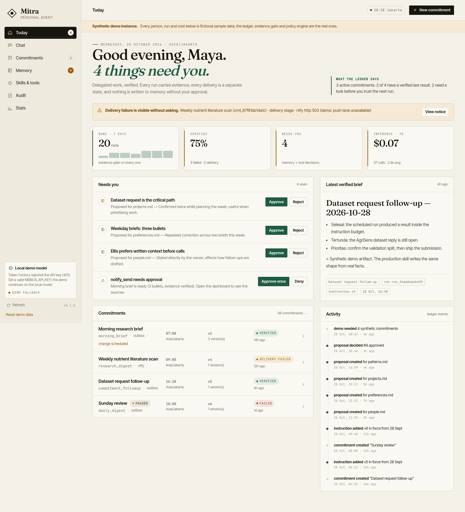
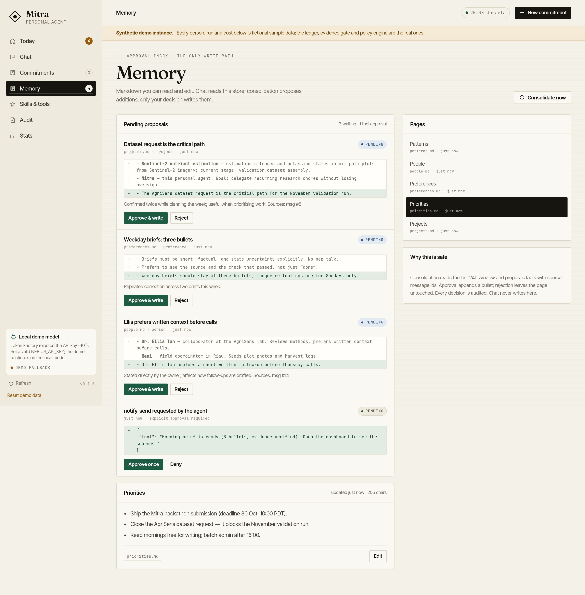
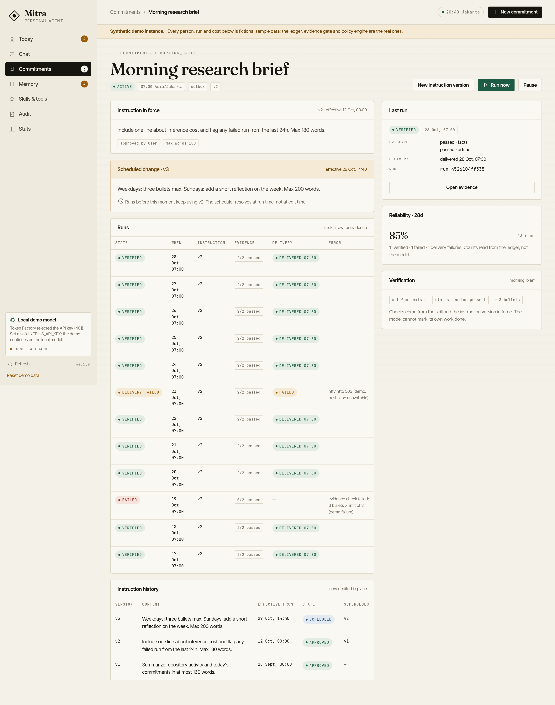
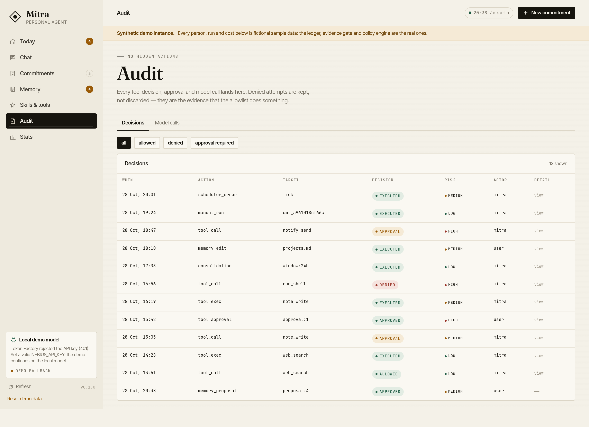
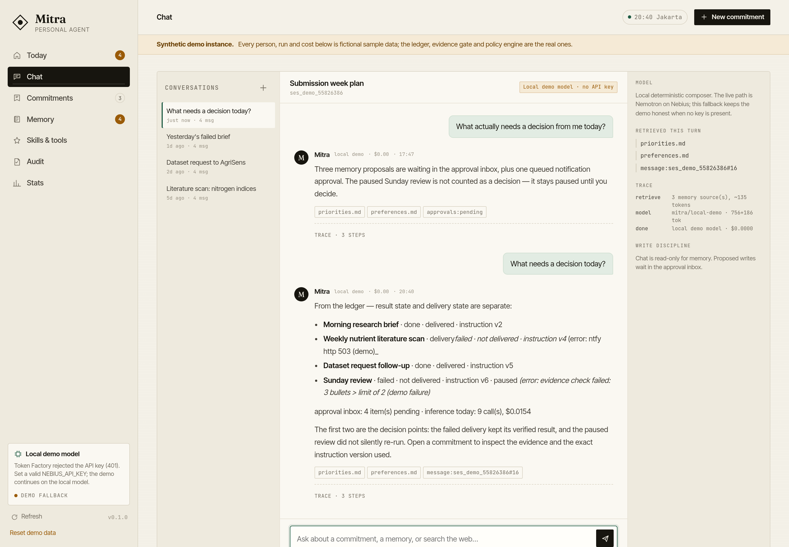
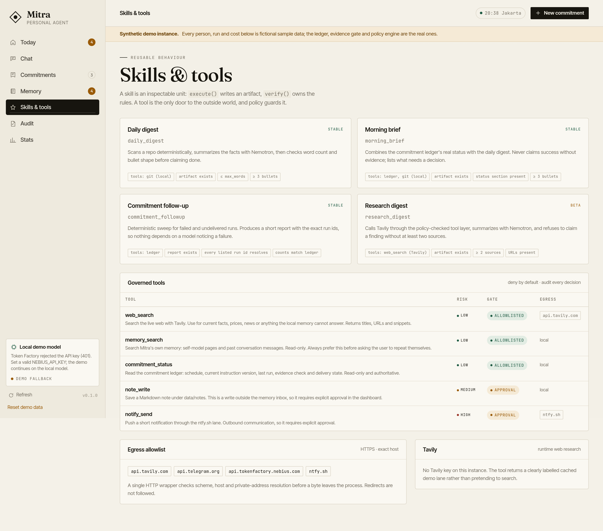
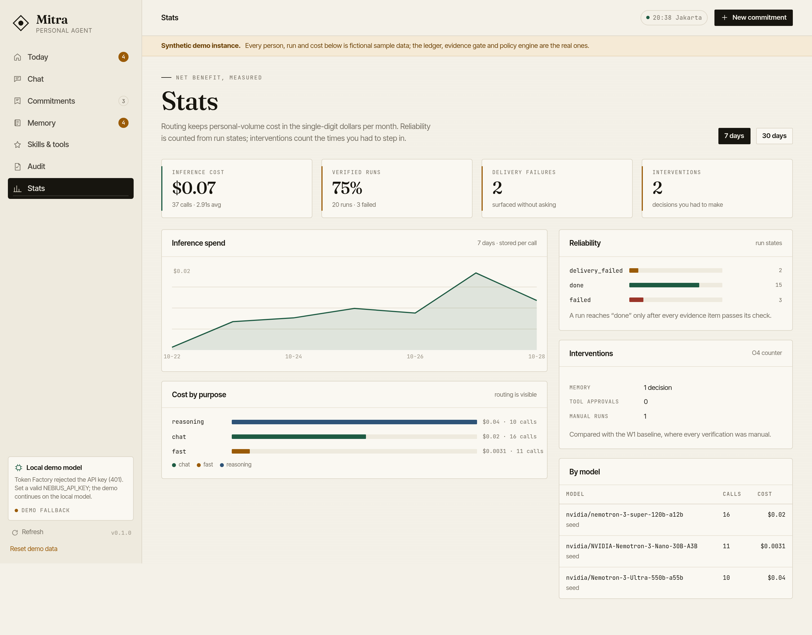

# Mitra

**A private, always-on personal AI that keeps its promises in writing.**

Built for the [NVIDIA × Nebius Global AI Hackathon](https://nebiusglobalaihackathon.devpost.com/) — **Personal AI Track**.
Inference runs on **NVIDIA Nemotron** models served by **Nebius Token Factory**; everything else — memory, scheduler, policy, evidence gate, dashboard — is this repository, MIT licensed, running on one VM you control.

**Live demo:** <https://ip-172-26-13-244.tail40f715.ts.net:10000/> — a seeded synthetic instance you can click through (and reset).



---

## The problem Mitra solves

Most "personal AI" is a chat window with a system prompt and amnesia. Ask it to take over recurring work and you get three new chores:

1. you have to re-explain the task every time the instructions change,
2. you cannot tell whether "done" means done or means *the model said so*,
3. failures are silent until you go looking for them.

Mitra is built around the **commitment** — a recurring piece of delegated work — and three invariants that are enforced in code, not in a prompt:

| Invariant | How it is enforced | Where |
|---|---|---|
| **O1 — only the currently approved instruction runs** | Instructions are append-only versions with an `effective_from`. The scheduler resolves the version effective *at run time*; a change dated "tomorrow" cannot leak into today's run. | `ledger.py`, `scheduler.py` |
| **O2 — "done" requires evidence that passed** | A run cannot reach `done` unless every evidence item (facts + artifact) has a *passed* check from the skill's deterministic `verify()`. The model's prose is never the proof. | `runner.py`, `ledger.complete_run` |
| **O3 — a failure surfaces without being asked** | Delivery is a separate stage from execution. A delivery failure becomes `delivery_failed` + a `NOTICE` in the outbox + a banner in the dashboard — never a silent gap. | `runner.py`, `delivery.py` |

Everything else follows from those three: an approval inbox for memory writes, a governor for every tool call, a ledger that records cost per call, and a dashboard that shows the ledger *as it is* rather than a summary of it.

## What is in this repository

```
src/mitra/
  ledger.py          SQLite ledger: commitments, instruction versions, runs, evidence,
                     delivery, sessions, messages, proposals, approvals, audit, model calls.
                     Enforces O1/O2/O3 as database-level invariants.
  runner.py          One run: resolve instruction → execute skill → check evidence →
                     complete or fail → deliver as a separate stage → notice on failure.
  scheduler.py       Due-commitment tick loop (in-process, single user by design).
  policy.py          Policy engine: allowlist, risk tiers, egress hosts, approvals, audit.
  tools.py           The only door to the outside world: web_search, memory_search,
                     commitment_status, note_write, notify_send.
  agent.py           Chat loop with tool calls, retrieval, budget guard, trace capture.
  consolidation.py   Nightly memory proposals from the last window — never direct writes.
  skills/            daily_digest, morning_brief, commitment_followup, research_digest.
  models/router.py   Purpose → model routing (fast / chat / reasoning) + cost accounting.
  models/demo.py     Deterministic local composer used when no API key is present.
  web/app.py         FastAPI app: dashboard, JSON API, SSE chat stream, security headers.
  web/static/        The dashboard — vanilla ES modules, no build step, self-hosted fonts.
docker/              Dockerfile entrypoint + Caddyfile for a TLS front door.
scripts/             serve.py, seed_demo.py, capture_screens.py, smoke_test.py,
                     demo_vertical_slice.py, run_scheduler.py, ntfy_ping.py.
tests/               44 tests: ledger invariants, policy, agent, consolidation, HTTP surface.
docs/                architecture, problem statement, validation plan, media, feedback.
```

## Run it

### One command (Docker)

```bash
docker compose up -d --build
# → http://localhost:8080
```

The container seeds a synthetic demo instance on first boot (persona, commitments, 20 runs, proposals, audit trail), runs as a non-root user, and keeps state in a named volume. With no `NEBIUS_API_KEY` it uses the deterministic local model and labels itself as demo in the UI.

### From source

```bash
python3 -m venv .venv && source .venv/bin/activate
pip install -e ".[dev]"

# optional: NEBIUS_API_KEY, TAVILY_API_KEY, NTFY_TOPIC — everything degrades honestly without them
cp .env.example .env

.venv/bin/python scripts/seed_demo.py --fresh           # synthetic demo instance
MITRA_DATA_DIR=data/demo MITRA_DEMO_MODE=1 \
  .venv/bin/python scripts/serve.py --port 8080         # dashboard
.venv/bin/python scripts/run_scheduler.py --once       # one scheduler tick against real skills
.venv/bin/python -m pytest -q                          # 44 tests
```

### Public demo hardening

Set `MITRA_DASHBOARD_TOKEN` to require `?token=…` (cookie is then set for the session). `MITRA_DEMO_MODE=1` turns on the synthetic-data banner, the demo guard (rate limiting) and the reset button. Add `-f docker-compose.tls.yml` with `DEMO_DOMAIN` to terminate TLS in front of the app.

## Using Nemotron on Nebius Token Factory

Three purposes, three models, one router (`src/mitra/models/router.py`):

| Purpose | Model | Used for |
|---|---|---|
| `fast` | `nvidia/NVIDIA-Nemotron-3-Nano-30B-A3B` | extraction, classification, cheap tool-argument work |
| `chat` | `nvidia/nemotron-3-super-120b-a12b` | dashboard conversation, tool calling |
| `reasoning` | `nvidia/Nemotron-3-Ultra-550b-a55b` | planning, consolidation, research synthesis |

The router records every call — model, purpose, tokens, latency, cost — into the ledger, so the **Stats** view is a measurement, not an estimate. A daily budget ceiling (`MITRA_DAILY_BUDGET_USD`) stops runaway spend and surfaces the reason in the UI.

### Honest note about this build

The submitted demo instance runs with `provider: demo`. The Nebius API key available during the build returned `401 Unauthenticated` (verified with a direct `GET /v1/models` against both `api.tokenfactory.nebius.com` and `api.studio.nebius.ai`), so live inference was not demonstrable. Rather than fake it:

- the live path is fully implemented and covered by tests with a stubbed client (`tests/test_agent.py`, `tests/test_router.py`);
- the fallback is a deterministic local composer that reads the *real* ledger — it cannot invent a run, an approval, or a cost;
- every surface that depends on inference says "Local demo model · no API key";
- `scripts/smoke_test.py --all` is the first command to run with a valid key.

Set `NEBIUS_API_KEY` and restart: the router probes the key at startup, flips `provider` to `nebius`, and the same UI runs on Nemotron.

## The dashboard

Seven views, all reading the same ledger.

| View | What it is for |
|---|---|
| **Today** | What needs a human decision, what ran, what is broken, latest verified brief |
| **Chat** | Conversation with retrieval, tool trace, per-turn cost, and a read-only write discipline |
| **Commitments** | The delegated work, its schedule, the instruction version in force |
| **Commitment detail** | Every run, every evidence item with its check result, delivery state, instruction history |
| **Memory** | Markdown self-model + the approval inbox (diff preview, approve → append, reject → untouched) |
| **Skills & tools** | Inspectable skills with their checks; every tool with risk tier, gate and egress host |
| **Audit** | Every decision, including the denied ones — that is the point |
| **Stats** | Cost, reliability, interventions, cost by purpose, calls by model |

| Memory (approval inbox) | Commitment detail | Audit |
|---|---|---|
|  |  |  |

| Chat | Skills & tools | Stats |
|---|---|---|
|  |  |  |

Mobile: layout collapses to a single column with a slide-over navigation rail (`docs/media/mobile-today.png`, `mobile-chat.png`, `mobile-memory.png`).

## Correctness, not vibes

- **Evidence gate.** `ledger.complete_run()` raises if any evidence item is unpassed. The runner has no path to `done` that skips it.
- **Version resolution.** `instruction_versions` are append-only; `resolve_instruction_version(commitment, at)` picks the version effective at the run timestamp. Tests cover "a change effective tomorrow does not apply today".
- **Delivery is separate.** `mark_delivery_failed()` never mutates the run's evidence; the verified artifact survives a delivery failure.
- **Policy before egress.** Every tool declares risk and egress hosts; `PolicyEngine` checks scheme, host, and private-address resolution through a single HTTP wrapper. Denials are audited, not dropped.
- **Memory writes need a human.** Chat is read-only against the self-model; consolidation only *proposes*.
- **Tests.** 44 tests covering ledger invariants, policy/approvals, the agent loop, consolidation, and the HTTP surface. `ruff check` and `ruff format --check` are clean.

## Limitations (deliberate)

- Single user, single process. The scheduler is in-process; scale-out is out of scope.
- Memory is lexical (SQLite + Markdown search), not embeddings. Retrieval quality is honest about what it found.
- Demo data is synthetic (persona "Maya Rahman"); the code paths, ledger, policy and gate are real.
- The ntfy lane fails in the demo on purpose — O3 is only believable if you can see a failure.

## Docs

- [docs/ARCHITECTURE.md](docs/ARCHITECTURE.md) — invariants, data model, design principles
- [docs/PROBLEM_STATEMENT.md](docs/PROBLEM_STATEMENT.md) — the locked problem and objectives O1–O5
- [docs/VALIDATION_SCENARIOS.md](docs/VALIDATION_SCENARIOS.md) — how the promises are checked
- [docs/FEEDBACK.md](docs/FEEDBACK.md) — what we learned using Nebius, Nemotron, and Tavily
- [docs/SUBMISSION.md](docs/SUBMISSION.md) — Devpost copy and the 3-minute demo script

## License

MIT — see [LICENSE](LICENSE).
