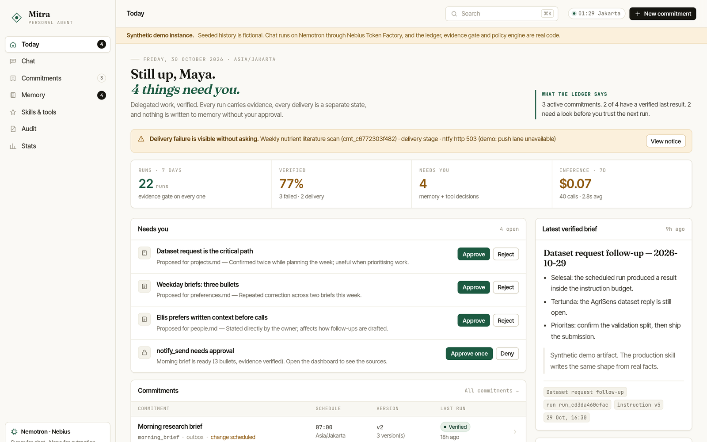
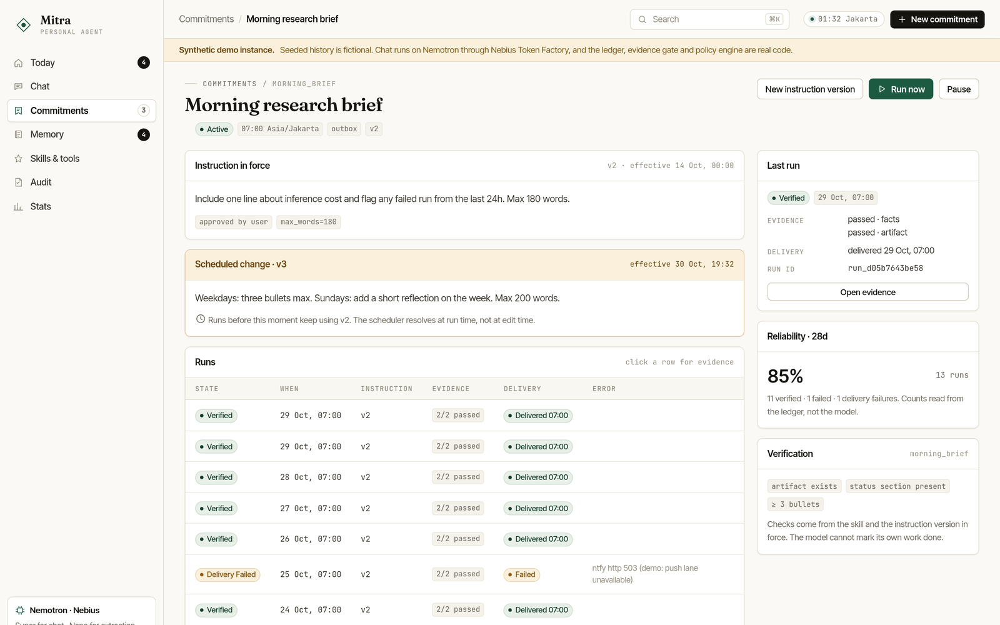
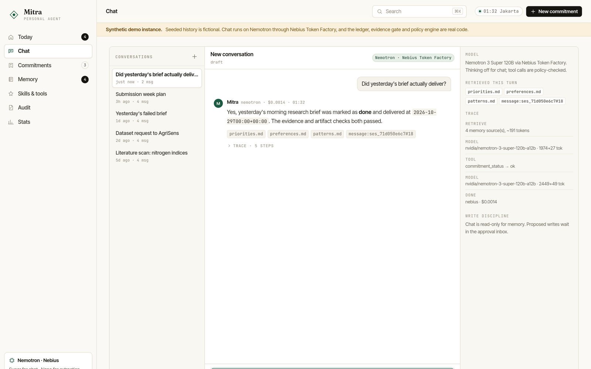

# Mitra — delegated work, verified

> **Paste this into the Devpost "About the project" field.** It is plain GitHub
> Markdown. Three image placeholders are marked in the text: upload the file they
> name from `submission/images/` at that point in the story and delete the
> placeholder line. (Their relative path is only so the file previews correctly
> here.)

**Live demo:** <https://mitra.pavernor.tech> · **Code:** <https://github.com/Alvnvnc/mitra> · **Track:** Personal AI

---

## Inspiration

Every "personal AI" demo ends the same way: an impressive conversation, then you
close the tab and nothing persists. Ask it to take over something recurring — a
weekly literature scan, a follow-up on a dataset request — and you inherit three
new chores.

You re-explain the task when the instructions change. You cannot tell whether
"done" means done or means *the model said so*. And when delivery breaks, you
find out days later, if at all.

We wanted the opposite: an agent whose memory is a file you can read, whose
"done" is a database constraint, and whose failures find you. That is Mitra —
Indonesian for *partner*, not *servant*.

## What it does

Mitra is a self-hosted personal agent with a dashboard, a scheduler, persistent
memory and governed tools. Its unit of work is the **commitment**: a recurring
piece of delegated work with versioned instructions, evidence-gated runs, and a
delivery state that is never assumed.

Three invariants are enforced in code, not in a prompt:

1. **Only the currently approved instruction runs.** Instructions are
   append-only versions with an `effective_from`. The scheduler resolves the
   version effective at *run* time, so a change dated "tomorrow" cannot leak
   into today's run.
2. **"Done" requires evidence that passed.** A run cannot reach `done` unless
   every evidence item has a passed check from the skill's deterministic
   `verify()`. The model writes prose; the code owns the rules.
3. **Failures surface without being asked.** Delivery is a separate stage from
   execution. A delivery failure becomes `delivery_failed`, writes a `NOTICE` to
   the outbox, and raises a banner in the dashboard — never a silent gap.

Around those invariants: an **approval inbox** for memory writes (chat is
read-only; nightly consolidation only proposes, with a diff and the source
message ids), a **policy engine** that governs every tool call (risk tier, egress
allowlist, approvals, audit — including denials), **cost-aware routing** across
three Nemotron tiers with per-call accounting, and seven dashboard views that
show the ledger as it is.

## How we built it

- **FastAPI + SQLite ledger** (`src/mitra/ledger.py`) is the spine. Commitments,
  instruction versions, runs, evidence, delivery receipts, sessions, proposals,
  approvals, audit entries and model calls live in one database, with the three
  invariants expressed as constraints and guarded transitions — `complete_run()`
  raises if evidence is unpassed.
- **Runner** (`runner.py`) executes one run: resolve instruction → run skill →
  record evidence → deterministic check → complete or fail → deliver as a
  separate stage → write a notice on failure.
- **Skills** are inspectable units with `execute()` and `verify()`:
  `daily_digest`, `morning_brief`, `commitment_followup`, `research_digest`.
- **Tools** (`tools.py`) are the only door to the outside world: `web_search`
  (Tavily), `memory_search`, `commitment_status`, `artifact_read` (reads the
  brief a run actually wrote), `note_write` (medium risk, approval), `notify_send`
  (high risk, approval). Every spec declares its risk tier and egress hosts.
- **Policy engine** (`policy.py`) checks allowlist, risk tier, approval state and
  egress host before a byte leaves the process. Denials are audited, not dropped.
- **Agent** (`agent.py`) is a tool-calling chat loop with retrieval from the
  self-model and the ledger, a tool-round budget, and a per-turn trace the UI
  renders (sources, tools, tokens, dollars). Running out of rounds triggers a
  final no-tools synthesis, so a turn ends in an answer rather than an apology.
- **Dashboard** (`web/`) is vanilla ES modules and hand-written CSS with
  self-hosted fonts — no build step, so the whole product is one
  `docker compose up`.

## How we used NVIDIA Nemotron and Nebius Token Factory

Inference is the only thing Mitra does not run itself. Every model call goes
through `ModelRouter` to **Nebius Token Factory's OpenAI-compatible endpoint**
(`https://api.tokenfactory.nebius.com/v1/`), and the router records model,
purpose, tokens, latency and cost into the ledger on the way back.

| Purpose | NVIDIA model | Where it is used |
|---|---|---|
| `fast` | `nvidia/NVIDIA-Nemotron-3-Nano-30B-A3B` | extraction and classification on the hot path |
| `chat` | `nvidia/nemotron-3-super-120b-a12b` | dashboard conversation and tool calling |
| `reasoning` | `nvidia/Nemotron-3-Ultra-550b-a55b` | planning, consolidation, research synthesis |

Why that matters for the product: a four-round tool-calling chat turn costs about
**$0.001–0.004**, an Ultra planning call about **$0.002**, a Nano extraction about
**$0.0001**. Mitra can therefore afford a hard daily ceiling
(`MITRA_DAILY_BUDGET_USD=0.50`) that is checked before *every* call, including
scheduled skill runs — and the Stats view adds up the same rows the router wrote,
so "cost" is a measurement, not an estimate.

The public demo runs live: `/api/health` reports `provider: nebius`, and chat
replies are labelled `nemotron` with the model id and the cost of the turn.
Token Factory removed the integration risk entirely — swapping the base URL was
the whole Nebius integration, and the official `openai` client worked unmodified.

## Challenges we ran into

**The hard part was not the model — it was making "done" mean something.** Early
versions let the model's prose decide completion. The fix was structural:
evidence items are rows, checks are deterministic functions, and `complete_run()`
refuses to transition unless every check passed.

**Version truth.** "Use my new instructions starting tomorrow" is easy to say and
easy to get wrong. Instructions became append-only rows with `effective_from`,
and the scheduler resolves the version against the *run* timestamp, not the
current wall clock.

**A promise is not a tool call.** Twice, a live Nemotron turn ended with "I need
to check the artifact. Let me look up yesterday's brief." — prose that announces
an action, with no tool call in the response. Treated naively, that sentence
becomes the answer. We now detect the pattern, nudge once, and record the nudge
in the trace.

**Inference that says what it is.** Our first Token Factory key returned `401`
for most of the build. Rather than fake it, the router was written to *fail
visibly*: it probes the key at startup, flips to a deterministic local composer
that reads the real ledger, and labels every surface "Local demo model". That
path is still in the image and still tested — it is what runs if the key dies
mid-demo. A degraded demo, never a lying one.

## Accomplishments we're proud of

- Three invariants that hold under tests, not just under demo conditions — 68
  tests, including "a change effective tomorrow does not apply today",
  "completion without evidence raises", and "a delivery failure leaves the
  verified artifact intact".
- An approval inbox that shows the diff before writing memory — and a rejection
  path that leaves the page byte-identical.
- Cost accounting measured per call, so the Stats view can be trusted.
- A dashboard that tells on itself: the demo instance deliberately includes a
  failed run and a delivery failure, because invariant 3 is only believable if
  you can see it.
- A public instance that can hold a real API key without being drainable: a
  5-second chat cooldown, 6 chats/hour and 20/day per visitor, an 80/day global
  ceiling, a $0.50 spend ceiling checked on every call, and admin actions behind
  a token. The port is bound to loopback; the Cloudflare Tunnel is the only way in.

## What we learned

- **Constraints beat prompts.** Every guarantee that mattered became a database
  invariant or a deterministic check. Prompts describe; constraints enforce.
- **Failure is a feature.** Making delivery a separate stage doubled the honest
  surface area of the product and made the demo more convincing.
- **A fallback must be louder than the model.** When inference is unavailable,
  the UI has to say so everywhere, not in a footnote.
- **OpenAI-compatible APIs remove integration risk.** Swapping the base URL was
  the whole Nebius integration.

## What's next

- Embedding-backed retrieval over the ledger (today it is lexical, and says so).
- A conformance suite that runs the same tool-calling prompts against all three
  Nemotron tiers and records where they differ.
- Multi-user households with per-person memory namespaces.
- Nebius Serverless Jobs for consolidation, so the VM can sleep between runs.

## Try it out

<https://mitra.pavernor.tech> — no signup, no token. The seeded history is
synthetic and the banner says so; the ledger, evidence gate, policy engine and
inference are real.

1. **Today** — what needs a decision right now (there is a deliberate delivery
   failure to look at).
2. **Commitments → Morning research brief** — runs, evidence checks, and v3 of
   the instruction that becomes effective tomorrow.
3. **Memory** — approve or reject a proposed memory write; the diff is shown
   first.
4. **Chat** — ask "Did yesterday's brief actually deliver?" and open the trace.
5. **Audit** — filter to `denied`: the refused tool calls are kept on purpose.
6. **Stats** — cost and reliability per call.

## Feedback on the platform

Our notes on Token Factory, Nemotron and Tavily — what worked, what cost us time,
and what we would like next — are in
[`docs/FEEDBACK.md`](https://github.com/Alvnvnc/mitra/blob/main/docs/FEEDBACK.md).

## Built with

`python` · `fastapi` · `sqlite` · `pydantic` · `uvicorn` · `openai` · `httpx` ·
`nvidia-nemotron` · `nemotron-3-super` · `nemotron-3-ultra` · `nemotron-3-nano` ·
`nebius-token-factory` · `cloudflare-tunnel` · `docker` · `vanilla-js` · `css` ·
`tavily` · `ntfy`
